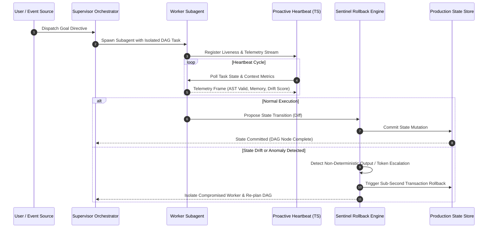

# JARVIS — Autonomous Multi-Agent AI Platform & Cyber Defense
> Modular multi-agent execution graphs, proactive telemetry loops, and self-healing deterministic state-rollback boundaries.

[](#)
[](#)
[](https://dev.to/nidhishakolkar)
[](LICENSE)

---

## 📌 Executive Summary

**JARVIS** is an autonomous multi-agent operating architecture designed to address the foundational failure modes of generative agentic workflows in production:

1. **Cascading Hallucination Collapses:** When concurrent agents execute parallel tasks, unvalidated intermediate outputs or race conditions cause state desynchronization (*state drift*), corrupting downstream task execution.
2. **Execution Boundary Compromises:** In autonomous runtime environments, dynamic subagent delegation requires strict validation gates to prevent unauthorized lateral escalation, token hijacking, and destructive execution.

By combining **hierarchical supervisor planning**, **AST-level code execution gates**, **proactive TypeScript heartbeat loops**, and **sub-second deterministic rollbacks (JARVIS-Sentinel)**, the platform establishes a resilient execution environment for complex developer and enterprise workflows.

---

## 🏗️ System Architecture


---

## 🔁 Runtime Execution & Anomaly Interception Sequence



---

## 🔑 Core Architectural Innovations

### 1. Hierarchical Dynamic Subagent Delegation
* **Supervisor-Worker Topology:** Decomposes complex directives into Directed Acyclic Graphs (DAGs) and dynamically spins up specialized runtime workers.
* **Self-Modifying Code Validation:** Generated code passes through multi-layer validation gates, static analysis checks, and AST parsing before execution inside isolated Docker containers.
* **See:** [`docs/ARCHITECTURE.md`](docs/ARCHITECTURE.md)

### 2. Proactive Telemetry & Heartbeat Loops
* **Continuous Liveness Monitoring:** Built with TypeScript and WebSocket event-driven telemetry to monitor agent workspace activity, detect execution stalls or developer fatigue, and dispatch proactive background tasks.
* **Distributed Synchronization:** Scaled visual and state execution pipelines to **600+ active nodes** using custom asynchronous queue brokers to prevent memory exhaustion and execution drift.
* **See:** [`docs/TELEMETRY_PROTOCOL.md`](docs/TELEMETRY_PROTOCOL.md) and [`src/types/telemetry.ts`](src/types/telemetry.ts)

### 3. JARVIS-Sentinel (Deterministic Rollback Engine)
* Maps transactional microservice interactions into dynamic execution graphs.
* Intercepts identity drift, session token escalation, and hallucination loops with **sub-second microservice state rollbacks** before corrupted data cascades to downstream systems.
* **See:** [`docs/ROLLBACK_ENGINE.md`](docs/ROLLBACK_ENGINE.md) and [`src/sentinel/rollback_engine.py`](src/sentinel/rollback_engine.py)

---

## 📚 Technical Articles & Published Deep-Dives

Engineering post-mortems and architectural breakdowns authored on **DEV Community** and **Medium**:

1. 📖 **[Self-Healing Execution Graphs — Catching Cascading Agent Failures Before Production](https://dev.to/nidhishakolkar)**  
   *Architectural analysis on why standard agent loops fail in production and how deterministic state checkpoints prevent cascading hallucinations.*
2. 📖 **[State Drift in Parallel Execution Systems — Concurrency and Monotonic Synchronization](https://medium.com/@nidhishakolkar01)**  
   *Exploration of race conditions and desynchronization when dispatching parallel agent branches.*
3. 📖 **[I Built a 600+ Node AI Orchestration Infrastructure in n8n — Engineering Post-Mortem](https://dev.to/nidhishakolkar)**  
   *Operational retrospective dissecting memory bottlenecks and execution overhead in scaling visual agent graphs.*
4. 📖 **[How I Built a Proactive Heartbeat Loop in TypeScript](https://dev.to/nidhishakolkar)**  
   *Breakdown of autonomous agent liveness monitoring, event-loop telemetry, and self-triggering agents.*

---

## 📂 Repository Structure

```
.
├── README.md                  # System overview and architectural diagrams
├── LICENSE                    # MIT License
├── docs/
│   ├── ARCHITECTURE.md        # Technical specification of Supervisor-Worker DAG orchestration
│   ├── ROLLBACK_ENGINE.md     # Algorithmic design of Sentinel deterministic rollback boundaries
│   └── TELEMETRY_PROTOCOL.md  # Specification for proactive heartbeat loops & event telemetry
└── src/
    ├── types/
    │   └── telemetry.ts       # TypeScript interfaces for workspace liveness & event telemetry
    ├── orchestration/
    │   └── supervisor.py      # Abstract interfaces for DAG planning & AST validation gates
    └── sentinel/
        └── rollback_engine.py # Reference implementation of graph transaction rollback triggers
```

---

## 🔒 Source Code Access & Live Walkthrough

> **Note on Codebase:** The core runtime and proprietary orchestration engine are maintained in a private repository for security and intellectual property protection.  
> 
> For engineering leads, technical recruiters, and founders who would like an in-depth code walkthrough, a live screen-share demonstration, or private collaborator access:
> * **Founder / Lead Architect:** Nidhish Akolkar
> * **Email:** [nidhishakolkar1@gmail.com](mailto:nidhishakolkar1@gmail.com)
> * **LinkedIn:** [linkedin.com/in/nidhish-akolkar](https://linkedin.com/in/nidhish-akolkar)
> * **GitHub:** [github.com/nidhishakolkar01-lgtm](https://github.com/nidhishakolkar01-lgtm)
